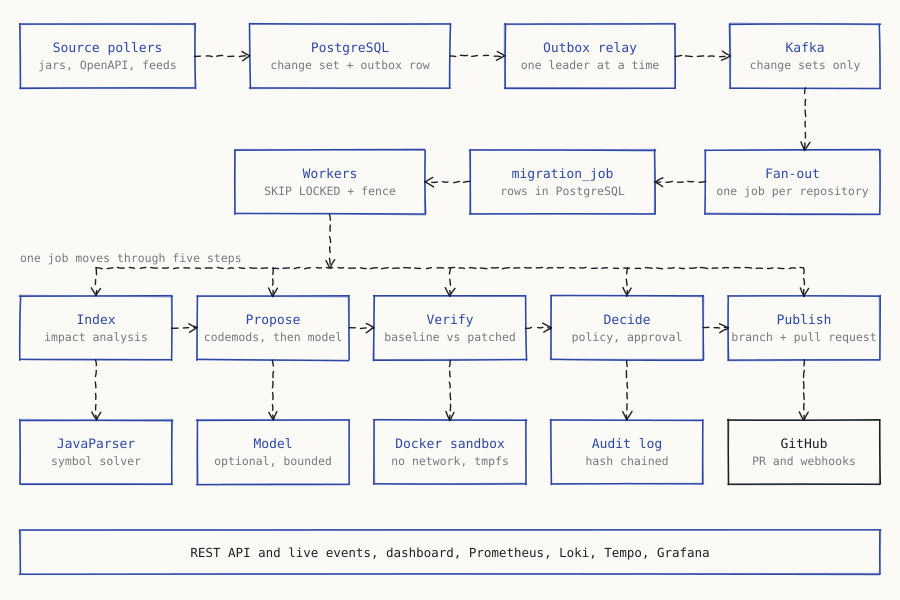
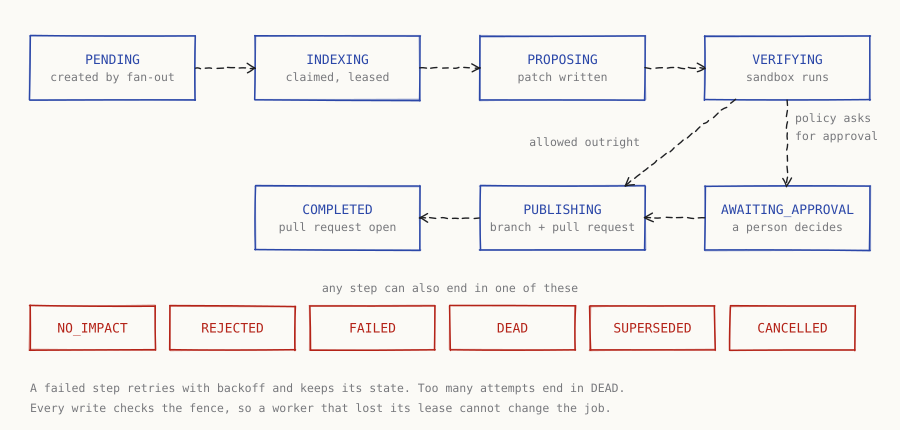
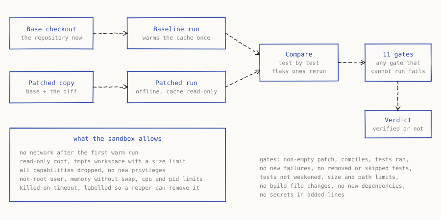
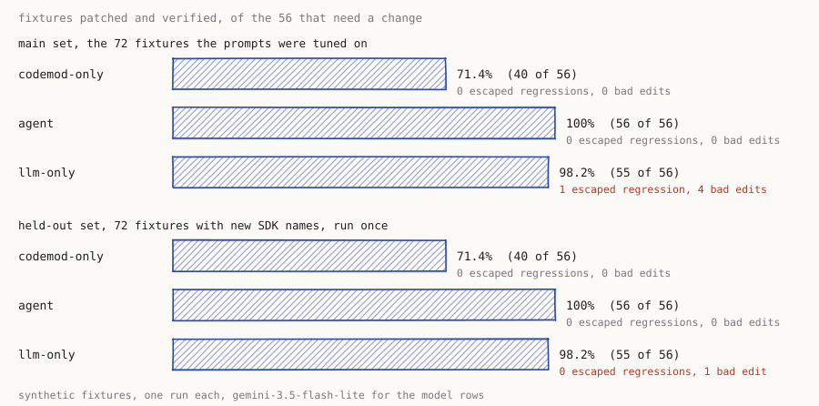
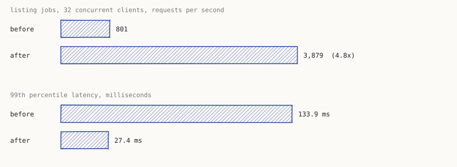

# Rook

Rook watches the third-party APIs and SDKs a codebase depends on. When one of them ships a breaking change it works out which files in which repositories are affected, writes the migration, proves in a sandbox that the tests still behave the same, and opens a pull request with the evidence. A person decides what merges.

Everything here runs locally. Nothing in this repository is deployed anywhere, and every number below comes from a run I did on my own machine.

## The short version

| | |
|---|---|
| Evaluation set | 72 generated fixtures, 56 of which need a change |
| Codemods only | 40 of 56 fixed, 71.4% |
| Codemods plus the agent (Gemini 3.5 Flash Lite) | 50 of 56 fixed, 89.3%, 0 escaped regressions |
| Listing jobs, 32 concurrent clients | 3,879 requests a second, p99 27.4 ms |
| Before the API key fix | 801 requests a second, p99 133.9 ms |
| Signed webhook intake, 32 concurrent clients | 2,845 deliveries a second, p99 27.0 ms |
| Tests | over 1,000 unit and 360 integration, plus the dashboard's unit and browser tests |
| Stack | Java 21, Spring Boot 4, PostgreSQL 16, Kafka, Next.js, Docker |

- A poller reads OpenAPI documents, release feeds and Maven artifacts and turns each new version into a typed change set: a method renamed, a class moved, an argument removed, an enum value gone.
- A change set fans out to every repository that watches that source. Each (change set, repository) pair becomes one durable job.
- Impact analysis reads the repository with a real symbol solver and says where the change lands, with a confidence on every location.
- Deterministic codemods write the patch first. A bounded model loop handles what the codemods leave over. On the evaluation fixtures it lifts the codemods from 71.4% to 89.3% with Gemini 3.5 Flash Lite, and a small local model added nothing. The results section has the numbers.
- The patch is built and tested twice in a Docker sandbox, once on the base and once patched, and eleven gates decide whether it counts as verified.
- A policy decides: allow, ask for approval, or deny. Every decision lands in a hash-chained audit log.
- The pull request carries the impact, the diff, the verification result and the policy decision.

## The story

I wanted a project where the interesting part was not the model call. Updating a call site after an SDK renames a method is mostly mechanical, and the hard part is trust. Where exactly does the change land? Did the patch break something the existing tests do not cover? What happens when a worker dies halfway through, or when GitHub delivers the same webhook three times?

So the model is the smallest part of Rook. Most of the code is about making each step safe to repeat, easy to inspect and honest about what it did not check. Jobs are claimed from Postgres with leases and fencing tokens. Messages go through an outbox. The sandbox has no network and a read-only root. The evaluation lab scores strategies on fixtures with hidden tests, and it reports the cases where it produced nothing.

The first version of the pipeline passed its tests and still would not start inside its own container image. That finding, and the one where reading a job list was four times slower than it needed to be, are written up under Incidents. Both came from running the system rather than testing its parts.

## The long version

### How a change travels





Postgres is the source of truth for job state. Kafka only carries change sets from the poller to the fan-out, and jobs are never claimed from Kafka.

A worker claims the next job with one statement: a CTE picks a claimable row with `for update skip locked`, sets the lease owner and expiry, bumps the fence and returns the previous owner so a takeover can be recognised. Every later write (advance, retry, finish, heartbeat) is conditional on the fence, so a worker that lost its lease cannot write anything. A partial unique index allows one running job per repository, which makes that rule a fact of the database rather than something the code has to remember.

### Modules

| Module | What it holds |
| --- | --- |
| rook-core | Domain types, ids (UUIDv7), hashing, JSON, error codes. No Spring. |
| rook-db | Flyway migrations V1 to V7 and the outbox writer. |
| rook-changes | OpenAPI differ, jar API differ (ASM), changelog classifier, Maven and feed pollers, safe HTTP fetcher, change ingestion. |
| rook-codeintel | Source indexing and impact analysis with JavaParser and its symbol solver. |
| rook-workflow | Job repository, runner, worker pool, outbox relay, fan-out. |
| rook-agent | Model clients, codemods, the bounded agent loop, three strategies. |
| rook-verify | Docker sandbox, baseline versus patched verifier, report parsing, gates. |
| rook-eval | Fixture generator, strategy runner, scoring and reports. |
| rook-control | Policy engine, approvals, audit log, budgets, API keys, rate limiting. |
| rook-github | App authentication, webhooks, REST client, git checkout and publishing. |
| rook-pipeline | The four job step handlers that tie the modules together. |
| rook-server | Spring Boot application, REST API, server sent events, metrics, tracing. |
| rook-loadtest | A small load generator written with virtual threads. |
| rook-testkit | Test helpers: Testcontainers setup, a fake GitHub, a fake clock. |
| dashboard | Next.js application for reviewers. |

### Detecting changes

The OpenAPI loader is my own small model over Jackson YAML. Schemas are compared per component and field path, and whether a change is breaking depends on the direction the schema is used in. A response-only enum value that disappears still counts as breaking, because client code comparing against it silently stops matching.

Jar surfaces are diffed with ASM so the rename and move heuristics stay under my control. Renames are heuristics, so every one carries a confidence, and the differ never claims certainty. Changelog text is classified by regular expressions into advisory events and migration notes. Advisory events never start a migration on their own, they only enrich real diffs.

Fetching goes through one class that allows only http and https, rejects user info, resolves DNS once and pins the address, re-validates every redirect hop, caps the decompressed size and puts a total time budget on the transfer. Private, loopback, link-local, metadata and CGNAT ranges are blocked.

### Finding what a change touches

Only usages whose name matches a changed symbol are sent to the symbol solver, which keeps the cost proportional to the change. Resolution runs against the repository sources plus the jars of its current dependency versions. Each location is `RESOLVED` (the solver confirmed the owner), `HEURISTIC` (name and type match) or `TEXTUAL` (only a string matched). The policy sets the lowest confidence a migration may act on, and textual-only results go to review.

Sensitive files such as `.env`, keys, credentials and state files never enter the index and never reach a prompt.

### Writing the patch

Codemods act only on locations the impact analysis produced and report what they handled, so the agent is handed only what is left. Method renames use JavaParser's lexical printer. Everything else edits exact source ranges, which keeps diffs small. Dropping an argument is refused when the argument might have side effects.

The model loop is bounded by iterations, tokens, cost, wall clock and tool calls. `finish` is never trusted: the sandbox runs the tests first and failures go back to the model as repair rounds. Prices are never hard coded. A model that is not in the configured price table is refused, so a budget can never price a call at zero by accident.

### Proving the patch

Every sandbox run is a Docker container with no network, a read-only root, a tmpfs for scratch space, all capabilities dropped, `no-new-privileges`, a non-root user, memory without swap, CPU and pid limits, and a unique name with labels so a reaper can remove leftovers. The first run for a repository warms the dependency cache with the network on. Every later run is offline with the cache mounted read only, and the build happens in a size-limited tmpfs copy of the source. A hostile build can neither poison the cache nor fill the host disk.

Baseline and patched results are compared test by test. Flaky failures are rerun and excluded. The gates are deterministic and any gate that cannot be evaluated fails: a non-empty patch, it compiles, tests actually ran, no new confirmed failures, no removed or newly skipped tests, tests not weakened, size limits, allowed paths, protected files, no added dependencies and no secrets in added lines.



### Deciding what may ship

The policy engine is a pure function. A deny beats an approval request, which beats an allow, and every reason has a stable code. Sensitive and protected paths are denied whatever the policy says. Policies are versioned rows per installation or repository.

The audit log chains each entry to the previous one with SHA-256 over length-prefixed parts. Writers serialise with an advisory lock and the table is append only through triggers. Truncating the tail cannot be detected from inside the table, only against a head hash recorded elsewhere, and the verify endpoint accepts one.

Budgets use reservations under a row lock. Settlement records the real cost, which can exceed the reservation because the model call has already happened, so a reservation is a guard and not a hard cap on settlement.

### Publishing

GitHub access uses an App: an RS256 JWT built with the JDK `Signature`, installation tokens cached with a single flight per installation, and credentials passed to JGit as a provider so they never reach `.git/config`. Webhooks are verified with a constant-time HMAC comparison and recorded by delivery id before they are handled.

Publishing is idempotent by construction. The branch name comes from the job id, an existing open pull request is returned instead of a new one, an existing remote branch is reused after a crash between push and pull request creation, and a diverged branch is refused rather than forced. Rook never pushes to the default branch.

### The dashboard

A Next.js application with server actions. The API key lives in an HTTP-only cookie and the browser never sees it. It lists jobs, shows the diff with the verification gates, the policy decision and the impact graph, lets a reviewer approve, reject, cancel or retry, and follows a live feed over server sent events. Further pages cover change sets, repositories, policies, usage, the audit log and the evaluation results.

### Watching it run

Micrometer metrics are exposed in the Prometheus format: jobs by state, step outcomes and durations, lease reclaims and losses, outbox backlog and age, dead letters, fan-out, source polls, rejected requests, verification results and durations, sandbox containers reaped. `deploy/observability` holds the Prometheus scrape config and eleven alert rules, a Loki config with Alloy shipping container logs, a Tempo config, and a Grafana dashboard of thirteen panels, all provisioned from files. A test checks that every metric name used in an alert or a panel is registered in the code, so a renamed meter cannot leave a dashboard empty.

Tracing is wired through OpenTelemetry with one span per job step and sampling off by default (`ROOK_TRACE_SAMPLE`). Logs are JSON, and carry the trace id when tracing is on.

### Deploying

`deploy/docker/server.Dockerfile` builds the server image and `dashboard/Dockerfile` builds the dashboard. `deploy/compose/stack.yml` starts Postgres, Kafka, the server and the dashboard, and `deploy/compose/observability.yml` adds the monitoring stack. I started the first one, waited for the health check and read the API with the admin key. I also started the monitoring stack and checked that Grafana provisions its three datasources and the dashboard, that Prometheus loads all eleven rules, that Loki receives the logs Alloy ships, and that a span posted to the OTLP port can be read back from Tempo. `deploy/terraform` describes one Docker-capable EC2 host, an RDS Postgres instance, an encrypted work volume and the security groups. It passes `terraform fmt` and `terraform validate`. I have not applied it to an account.

The sandbox needs a Docker socket, which is why the host is an instance and not a Fargate task.

## Threat model

The assets are customer source code, the credentials Rook holds for GitHub and for models, and the integrity of what gets merged. The attackers I considered are a hostile upstream source, a hostile repository, a hostile pull request or webhook sender, and a stolen or over-privileged API key.

| Threat | What stops it |
| --- | --- |
| A source URL pointing at internal services | The fetcher blocks private ranges, pins DNS and re-validates redirects. |
| A repository whose build tries to escape or poison the cache | No network, read-only root and cache, tmpfs workspace, dropped capabilities, non-root user, memory and pid limits. |
| A build that fills the disk | The workspace is a size-limited tmpfs. A quota thread on bind mounts is only a second line, because it can overshoot between polls. |
| A model that edits files it should not | Path allow and deny lists, protected files, sensitive file patterns, and gates that fail on weakened tests or added dependencies. |
| Secrets in a prompt or a diff | Sensitive files never enter the index. A redactor runs over text and the secrets gate runs over added lines. |
| A forged or replayed webhook | HMAC with constant-time comparison, delivery ids recorded before handling, handlers written as upserts. |
| A stolen key reading another installation | Keys carry an installation and scopes. Cross-installation reads return not found. Failed authentication has its own stricter rate limit per address. |
| Quiet tampering with history | The audit chain breaks on any edit in the middle, and triggers refuse updates and deletes. |
| A worker writing after it lost its job | Fencing tokens on every write. |
| A runaway model bill | Per-job and monthly budgets with reservations, and a price table that refuses unknown models. |

Not covered: the Docker daemon is trusted, kernel escapes are out of scope, rate limiting is per node, and the standard policy still lets a reviewer approve a bad patch.

## Decisions that shaped it

Postgres for state and Kafka only for distribution. Jobs claimed from the database mean a restart never loses work and the queue is inspectable with plain SQL. No Redis, because nothing needed it.

Impact before patch. A patch with no verified location behind it is a guess, so every location carries a confidence and the policy can raise the bar.

Verification compares baseline to patched. Asking whether tests pass is weaker than asking whether this patch changed any result, and it makes a repository with failing tests usable.

The agent proposes and never decides. Policy, gates and a person decide.

One timeline per job. Server sent events read from a `job_events` table with a monotonic id and support `Last-Event-ID`, so a dropped stream resumes without depending on consumer group state.

## Incidents

Each of these was a real failure during the build.

The server would not start in its image.
Cause: three places asked for the random generator `L64X128MixRandom`, which lives in a JDK module the minimal Alpine runtime image does not ship. The tests ran on a full JDK and never saw it.
Fix: a small thread-safe generator in rook-core built on `ThreadLocalRandom`. The old code also shared one non-thread-safe generator between worker threads, which this removes.
Result: the compose stack starts, the server reports healthy and the log has no errors. The OpenTelemetry starter had also turned on metric export to a collector that is not there, and that is now off.

Reading the job list was four times slower than it should have been.
Cause: every authenticated request updated `last_used_at` on the same API key row, so concurrent requests with one key queued on the row lock.
Fix: read `last_used_at` with the key and write it only when it is more than a minute old.
Result: with 32 concurrent clients, 801 requests per second became 3,879 and the 99th percentile went from 133.9 ms to 27.4 ms.

Every sandbox verification failed with a non-zero exit.
Cause: `cp -a` into a tmpfs root fails with "preserving times: Operation not permitted", and the tmpfs was root owned so the build user could not write to it either.
Fix: `cp -R` and a tmpfs mode of 1777.
Result: baseline and patched runs complete in the verifier integration tests.

A job was still leased after the worker pool said it had stopped.
Cause: `stop` returned right after interrupting a busy worker, before the worker released its lease.
Fix: stop joins the interrupted worker for up to two seconds.
Result: a restart hands the job to another worker at once instead of after the lease expires.

The open stream gauge never went back to zero.
Cause: the stream pump set its running flag to false in the catch block, so the later `stop` saw false and skipped the decrement.
Fix: the flag is cleared only after the cleanup that reads it.
Result: found by a gauge assertion in the stream test, which now passes.

Impact analysis returned lines and columns of zero with empty snippets.
Cause: I had turned off token storage in JavaParser to save memory, and ranges come from tokens.
Fix: tokens stay on.
Result: locations carry real positions and snippets.

The agent did nothing with the local model.
Cause: `qwen2.5-coder:7b` through Ollama writes its tool call as JSON text in the message instead of the structured `tool_calls` field. The loop saw a reply with no tool call and stopped after a second.
Fix: the OpenAI-compatible client now accepts a reply that is only a JSON object naming a tool that was offered in the request, bare or inside a code fence. A name that was not offered stays plain text.
Result: the agent started calling tools. It still ended without an edit on every type-change fixture, which led to the next incident.

The agent could not know what to change.
Cause: the evaluation gave it no migration notes, and the repository does not contain the SDK, so for a parameter type change nothing told it that the new type was `Ref` or that `Ref` is built from a `String`. No model could have solved those 16 fixtures. Two smaller faults hid this: the hybrid strategy replaced the task preface with its own text, and the llm-only strategy never sent the preface at all.
Fix: the evaluation now renders the new SDK API for the types involved in each change, from the jar surface Rook already extracts, and both strategies send it.
Result: with the notes and Gemini 3.5 Flash Lite the agent fixed 10 of those 16. I changed the model and the prompt together, so I cannot say how much each contributed.

Gemini 3 rejected the second turn of every tool conversation.
Cause: its reply carries a `thought_signature` on each tool call, and the API returns a 400 if the next request does not send it back. The client dropped fields it did not know.
Fix: tool calls keep an opaque provider field, and the client reads it from replies and writes it back.
Result: multi-turn tool use works against the Gemini endpoint.

Still open: `successiveChangeSetsOfOneRepositoryFinishInDetectionOrder` failed twice in about twenty runs, with two neighbouring jobs of one repository finishing swapped. Sends are synchronous and idempotent, the unique index blocks overtaking and retries keep the job state, so I could not find the cause and could not reproduce it in the last sixteen runs. The integration tests are allowed one rerun, and I would rather have the explanation.

## Measured results

The machine is a Windows laptop with 16 logical processors and Docker Desktop. The load generator, the server, Postgres and Kafka all share it, so the numbers show the shape of the system and are not capacity figures.

### Evaluation lab

72 generated fixtures: nine kinds of change, four invented SDKs, two usage styles. Each is a small Maven project with tests the strategy never sees. Verification runs offline Maven on the host, not in Docker. The model rows ran `gemini-3.5-flash-lite` on the free tier through its OpenAI-compatible endpoint, one fixture at a time at about 13 requests a minute, with a budget of 16 iterations and 2 repair rounds per fixture.

| Strategy | Patched and verified | Escaped regressions | Edits that should not happen | Median time |
| --- | --- | --- | --- | --- |
| codemod-only | 40 of 56 (71.4%) | 0 | 0 | 43 ms |
| agent | 50 of 56 (89.3%) | 0 | 0 | 9.7 s |
| llm-only | 55 of 56 (98.2%) | 1 | 4 | 5.6 s |

The 56 are the fixtures that need a change. The other 16 need none and should be left untouched.

The agent gains all of its 10 fixtures on the two kinds the codemods cannot handle. It fixed 8 of 8 parameter type changes and 2 of 8 return type changes. The 6 return type fixtures it missed ended at the iteration limit without a patch. Everything the codemods already fixed it still fixes, and it makes no model call for those.



`llm-only` has the highest raw score and the worst safety record. It edited files that had to stay unchanged on 4 of the 8 deprecation-only fixtures, and on one return type fixture the visible tests passed while the independent ones failed. The agent had neither problem on this set, and I do not count `llm-only` as better on the strength of the first column alone.

Tokens, from the run: the agent called the model on 24 fixtures (the 16 type changes and the 8 deprecation-only ones, where it checks whether anything needs doing) with 301 calls, 735k input tokens and 10k output tokens, so roughly 30k input per fixture that used it. `llm-only` made 132 calls with 47k input and 14k output. At Gemini 3.5 Flash-Lite's paid prices of $0.30 and $2.50 per million tokens that run would cost about 30 cents. It cost nothing on the free tier, whose limits allowed this in one day.

One run each, on synthetic fixtures written by the same person who wrote the codemods, with one model. The run to run spread of a model is real: an earlier local model run changed several cells between two attempts. The agent also has the new SDK API in its prompt, which the codemods do not need, so the comparison is between tools given what each needs.

### Load

Thirty-two concurrent clients for twenty seconds after a five second warm-up. Raw results are in `docs/load`.

| Scenario | Requests per second | p50 | p95 | p99 | Failures |
| --- | --- | --- | --- | --- | --- |
| List jobs, before the key fix | 801.4 | 32.4 ms | 92.1 ms | 133.9 ms | 0 |
| List jobs | 3,879.1 | 6.9 ms | 17.3 ms | 27.4 ms | 0 |
| Signed webhook delivery | 2,845.4 | 9.9 ms | 19.7 ms | 27.0 ms | 0 |



With the default limits (a burst of 60 and 10 requests per second per key), 158 of 9,563 requests in ten seconds were accepted and the rest got `429`. That is the limiter working, and the rows above ran with the limits raised.

### Recovery

`ChaosIT` exercises the actions behind the `chaos` profile: expiring every lease, crashing workers and stopping the relay, all of them restricted to a key that is not tied to one installation. The recovery properties themselves are tested in rook-workflow with real Postgres and Kafka: a crashed worker loses no job and repeats no effect, a relay leader change loses no message, duplicate deliveries create each job once, and successive change sets of one repository finish in detection order, which is the test mentioned above.

### Tests

The last full `mvn verify` ran 1,029 unit tests and 364 integration tests across the Java modules, with a 70 percent line coverage gate per module. Four tests skip themselves through assumptions. I ran it in two parts: the first stopped at the ordering failure above, and the second started at that module with one rerun allowed and passed without needing it. The dashboard adds 66 unit tests and 13 browser tests, and the observability files are covered by a test that cross-checks metric names against the code.

## What I would fix next

The intermittent ordering failure, first.

Codemods for parameter and return type changes, which account for all 16 unpatched fixtures.

Why the agent runs to its iteration limit. On the six return type fixtures it never calls `finish`, and on two of the eight it applied a correct patch and still used all 16 iterations. I have not looked at the traces yet. The Anthropic client is tested against a local fake and has never called the real service.

A pipeline test that goes through the Docker verifier. The verifier has its own integration tests, but the end-to-end flow test uses a stub verifier, because getting an SDK jar into an offline sandbox cache inside that test was more work than I had left.

Agent-level metrics. Verification and job steps are metered. The agent's token and cost figures only reach the usage ledger, not Prometheus.

Rate limiting per node is fine for one instance. Several instances would need a shared limiter.

The Terraform has never been applied, and the deployment runs Kafka as a single node on the host. `.github/workflows/ci.yml` repeats the checks I ran by hand, and has never run, because this repository has no remote.

The dashboard end-to-end tests run against a mock API and not against the real server.

## Running it

You need JDK 21, Maven 3.9, Docker and Node 22.

```
mvn verify
```

runs the unit and integration tests for every module. Integration tests start Postgres and Kafka through Testcontainers.

```
cd deploy/compose
ROOK_ADMIN_KEY=<at least 32 characters> docker compose -f stack.yml up -d --build
```

starts Postgres, Kafka, the server on port 8080 and the dashboard on port 3001. Sign in to the dashboard with the admin key. Set `ROOK_SERVER_PORT` or `ROOK_DASHBOARD_PORT` if those ports are taken. To connect GitHub, also set `ROOK_GITHUB_APP_ID`, `ROOK_GITHUB_WEBHOOK_SECRET` and `ROOK_GITHUB_PRIVATE_KEY`. The server mounts the Docker socket and `/var/lib/rook`, because the sandbox starts sibling containers and needs the same path on both sides.

```
docker compose -f observability.yml up -d
```

adds Prometheus, Loki, Tempo, Alloy and Grafana on port 3000. Set `ROOK_TRACE_SAMPLE` to turn on tracing.

```
bash demo/run.sh
```

runs the evaluation on one fixture, prints the report, then shows the change that fixture expects. `demo/run.ps1` does the same on Windows. Pass a fixture name to pick another.

```
cd dashboard
npm ci
npm test
npx playwright test
```

runs the dashboard unit tests and the browser tests, which start the application against a small mock API and use the Chrome installed on the machine.

```
MODEL_API_KEY=<key> java dev.rook.eval.EvalCli run-model eval/fixtures eval/results - https://generativelanguage.googleapis.com/v1beta/openai gemini-3.5-flash-lite agent,llm-only 4500
```

reruns the codemod baseline and the model strategies against any OpenAI-compatible endpoint, one fixture at a time. The fourth argument filters fixture names, and `-` matches all of them. The last argument is the pause between model calls in milliseconds, for rate limits. A fixture whose model call fails after retries stops the run and keeps the finished fixtures, and running the same command again continues from there. The key is read from `MODEL_API_KEY` and is never written to a file. For a local model use `http://localhost:11434/v1` with Ollama and no key.

The load generator is `dev.rook.loadtest.LoadCli`, with `--scenario api-read` or `--scenario webhook`. The API contract is in `docs/openapi.yaml` and a test fails when the controllers and the document disagree.

## API

The contract is `docs/openapi.yaml`, and a test fails when the controllers and the document disagree. Everything under `/api/v1` needs a bearer key with a read, write or admin scope.

`GET /api/v1/jobs` lists jobs with a state filter, and `GET /api/v1/jobs/{id}` returns the whole story of one: its timeline, the impact, the proposal, the verification result, the policy decision, the approval and the pull request.

`POST /api/v1/jobs/{id}/approve`, `reject`, `cancel` and `retry` act on a job. Approving a job that has no pending approval returns a conflict, so a second approval of the same job is refused.

`GET /api/v1/events` streams job events as server sent events and resumes from `Last-Event-ID`.

`GET /api/v1/change-sets`, `/repositories`, `/sources`, `/usage`, `/policies/effective` and `/audit` read the rest of the state, and `GET /api/v1/audit/verify` checks the hash chain. `PUT /api/v1/policies` and `PUT /api/v1/budgets` change them.

`POST /webhooks/github` takes GitHub deliveries. It checks the HMAC signature and records the delivery id before handling anything.
